# The five main flows: walkthrough scenarios and test results

Run: 14 Oct 2026, automated browser test (Chromium, 390 x 844 phone viewport) against the production build in demo mode. **28 of 28 checks passed, no page errors.** Raw results: `../09_Evidence/flow_test_results.json`. Script: `../07_Engineering/e2e/flows.py`.

**How to read this.** Each flow is a realistic scenario (a groupware walkthrough in the sense of Pinelle and Gutwin 2002) with the social and mobile concept it exercises. The scenarios are made-up examples, not real users. These tests show the flows work end to end. They are **not** usability evidence: nobody outside the team has used them yet (see "Limits").

---

## F1. New listener: "What is this and why open it today?"
**Role:** visitor, then guest. **Concepts:** context of use, awareness of the curator, bounded asynchronous session. **Requirements:** R1, R2, R3.

| # | Step | Expected | Result |
|---|---|---|---|
| 1 | Open the site for the first time | Welcome story explains what Folio is and three reasons to open it today | Pass |
| 2 | Confirm the city | Brisbane is live; others show Coming soon | Pass |
| 3 | Swipe the three example stories | Reader, path to curating, curator journey | Pass |
| 4 | Land on Today | The Edition, the curator's name, a first-visit "New here?" card | Pass |
| 5 | Open a Liner Note | One checkable fact with a source link | Pass |
| 6 | Look for likes | None exist | Pass |

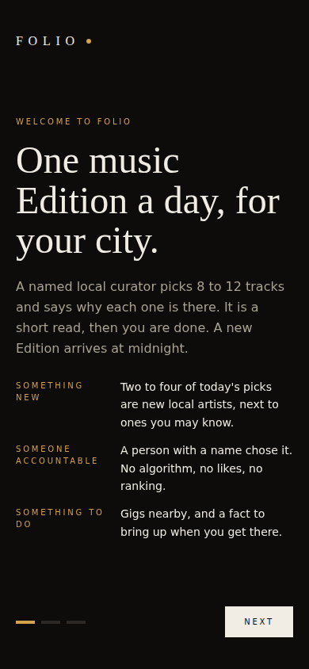 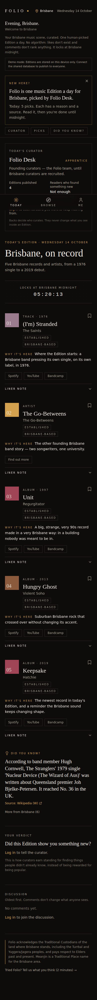 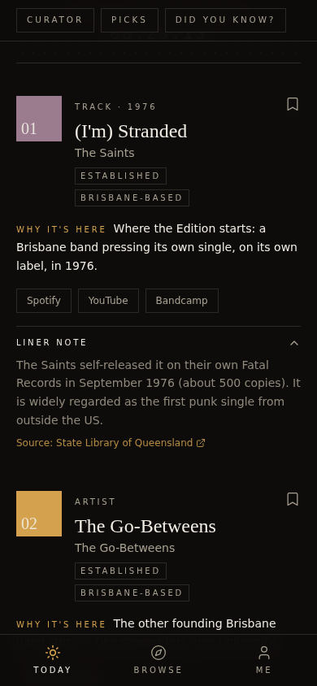

## F2. Returning listener: the daily read
**Role:** member. **Concepts:** communication anchored to artefacts; awareness with privacy; individual view. **Requirements:** R4, R5, R6.

| # | Step | Expected | Result |
|---|---|---|---|
| 1 | Sign up | Lands on Today, not a settings page | Pass |
| 2 | Comment on the Edition | Comment appears in order, no ranking | Pass |
| 3 | Answer the Discovery check | One answer allowed; "only the curator sees totals" | Pass |
| 4 | Save a pick | Appears privately under Me | Pass |
| 5 | Open Browse | Past Editions, curators, artists and Nearby events | Pass |
| 6 | Settings: add a picture | Picture shows and persists | Pass |

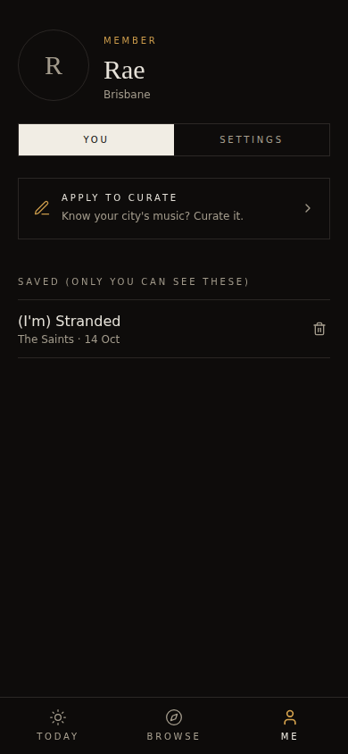 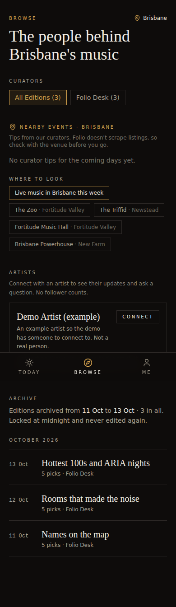 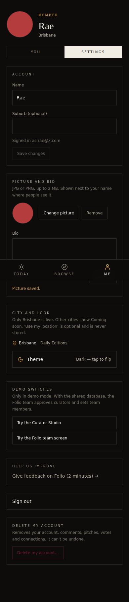

## F3. Artist: be heard
**Role:** artist. **Concepts:** coordination with a curator; asynchronous communication. **Requirements:** R8.

| # | Step | Expected | Result |
|---|---|---|---|
| 1 | Sign up as an artist | Lands in the artist space | Pass |
| 2 | Pitch a track to a curator | "Pitch sent" | Pass |
| 3 | Post an update | Visible to connected fans only | Pass (checked in F5) |

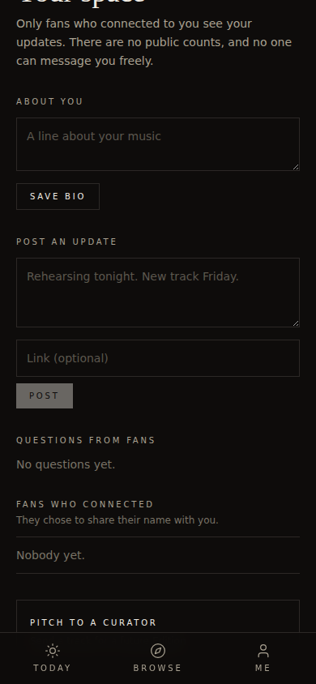 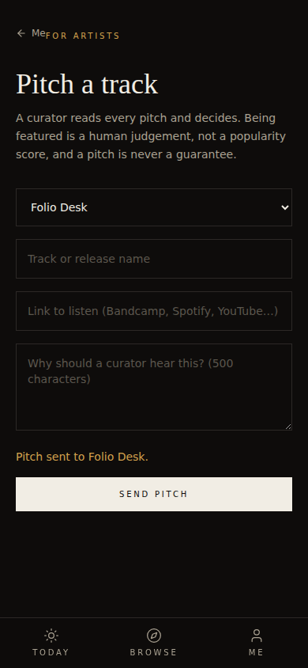

## F4. Curator: apply, get approved, publish
**Roles:** applicant, Folio team, curator. **Concepts:** coordination and accountability; individual views by role; the politics of the system (Winner; Akrich). **Requirements:** R9, R10.

| # | Step | Expected | Result |
|---|---|---|---|
| 1 | Apply to curate | "Application sent"; Me shows it as waiting | Pass |
| 2 | Team opens Team screen | One waiting application with the reason | Pass |
| 3 | Team approves | Moves to decided | Pass |
| 4 | Applicant logs in | Lands in the Curator Studio | Pass |
| 5 | Publish an empty Edition | Blocked with reasons | Pass |
| 6 | Publish 8 picks, 3 new artists, sources present | Published | Pass |

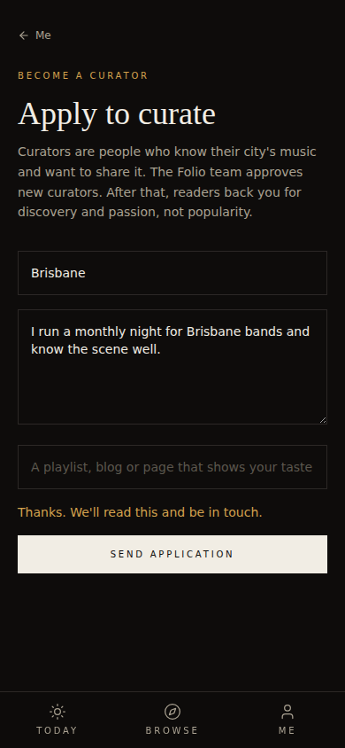 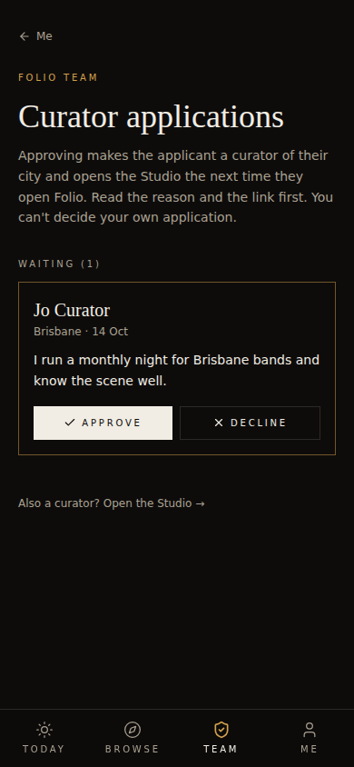 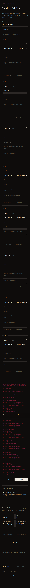 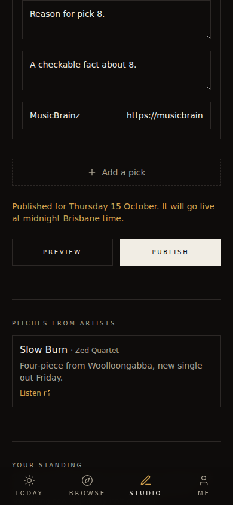

## F5. Listener and artist: a relationship without a feed
**Roles:** member, artist. **Concepts:** social presence; visibility vs privacy; Facebook Beacon as the counter-example. **Requirements:** R11.

| # | Step | Expected | Result |
|---|---|---|---|
| 1 | Fan finds the artist in Browse | Artist card listed | Pass |
| 2 | Fan connects | Artist's update appears | Pass |
| 3 | Fan asks one question | Shown as waiting | Pass |
| 4 | Artist opens their space | Sees the fan's name and the question | Pass |
| 5 | Artist replies privately | Fan sees the reply | Pass |

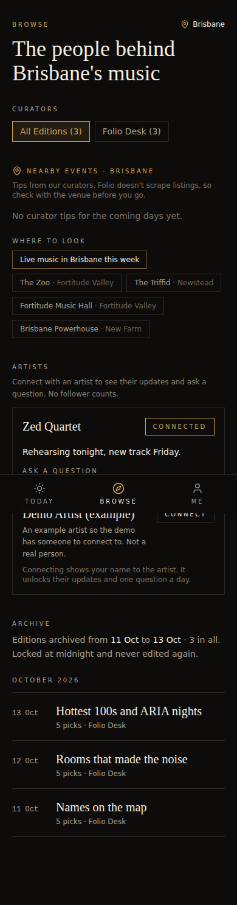 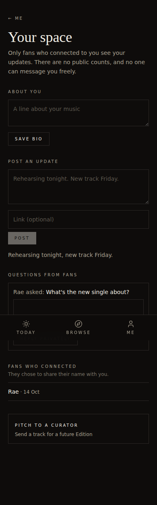 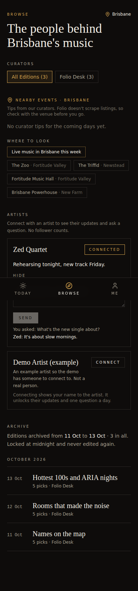

---

## Limits (say these before a marker finds them)
1. **Demo mode stores data per browser**, so this test used one device and switched accounts. It cannot show two people at once. Simultaneous use is shown by the live backend test (33 of 33, 12 Oct) and must be shown by the manual two-phone check.
2. **These are team-run checks.** The brief asks for users who are not on the team to use it unassisted. Record that in `05_Research_Evaluation/`.
3. Admin and curator screens in this test used the demo switch. On the live backend the team flag is set in the database.
4. Not covered: the gig queue (not built), source-link checks (not built), accessibility audit.
